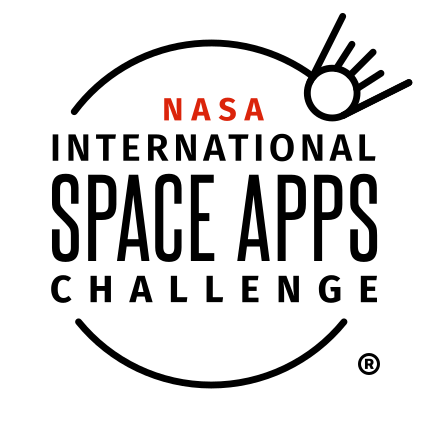
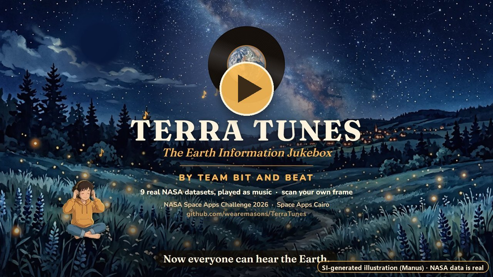
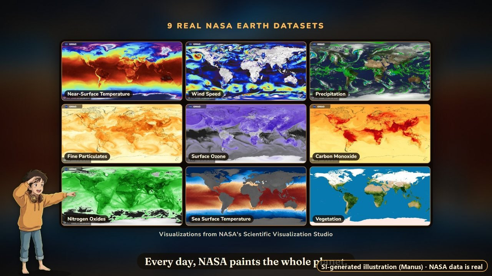
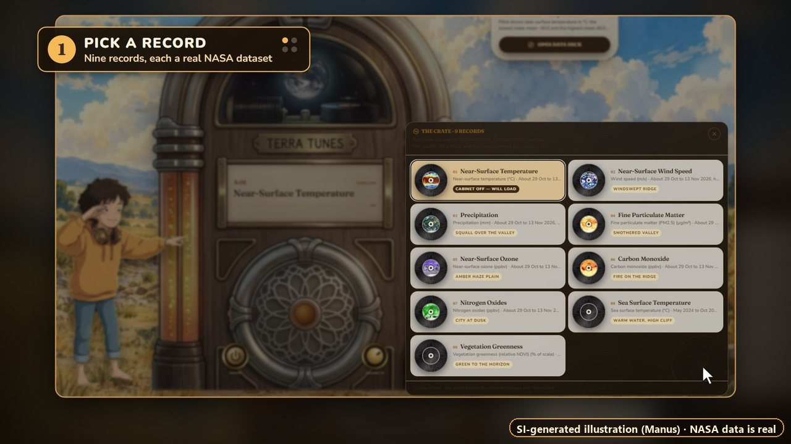
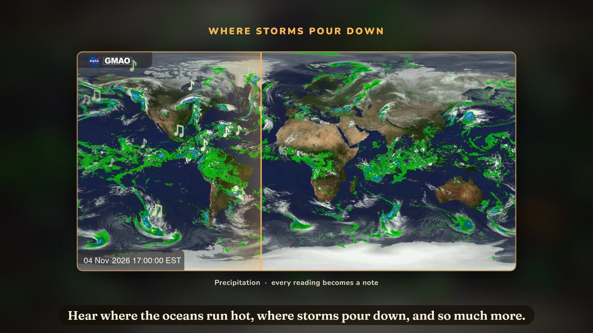
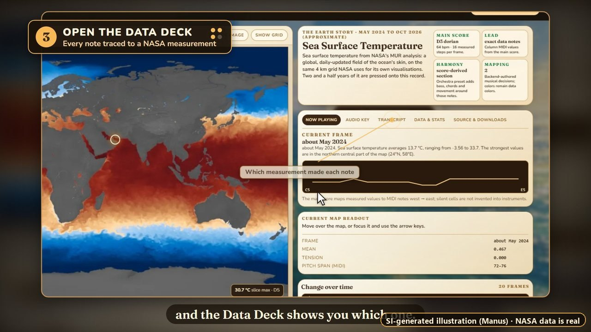
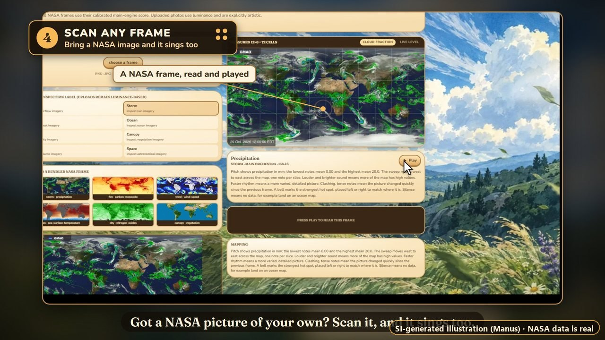
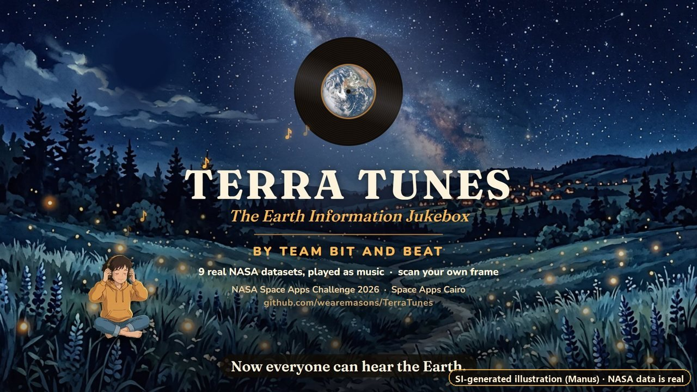
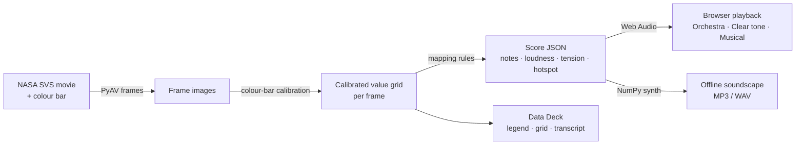
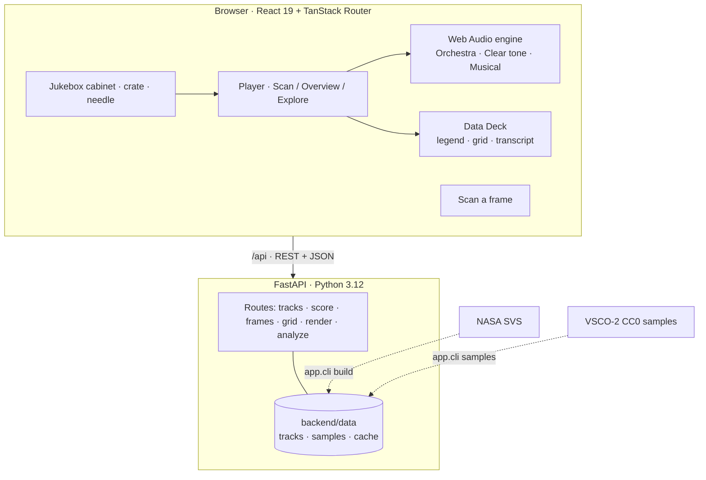

<p align="center">
  <a href="https://www.spaceappschallenge.org/">
    <picture>
      <source media="(prefers-color-scheme: dark)" srcset="docs/assets/brand/space-apps-logo-white.svg">
      
    </picture>
  </a>
  &nbsp;&nbsp;&nbsp;&nbsp;&nbsp;
  <a href="https://manus.im/"></a>
</p>

<h1 align="center">TerraTunes: The Earth Information Jukebox</h1>

<p align="center">
  <b>NASA paints the planet every day. TerraTunes lets you hear it.</b><br>
  Nine real NASA Earth datasets, played as music, built so that people who can't see the maps can still explore them.
</p>

<p align="center">
  
  
  
  
  
  
</p>

<p align="center">
  🙏 <b>Special thanks to <a href="https://manus.im/">Manus</a></b> for the <b>10,000 free credits</b>. We used every last one.<br>
  <sub>Manus's AI agent made our illustrations, opening film, the girl's animations, the guided-tour voices and the demo voiceover. <a href="#made-with-manus">See what it made →</a></sub>
</p>

<p align="center">
  <a href="https://youtu.be/J-_fbmuNxIA">
    
  </a>
  <br>
  <sub>▶ <a href="https://youtu.be/J-_fbmuNxIA"><b>Watch the 30-second demo on YouTube</b></a> (captioned)</sub>
</p>

---

## Contents

- [The idea](#the-idea)
- [What you can do](#what-you-can-do)
- [A look inside](#a-look-inside)
- [The nine records](#the-nine-records)
- [How data becomes music](#how-data-becomes-music)
- [Accessibility](#accessibility)
- [Honest by design](#honest-by-design)
- [Architecture](#architecture)
- [Quick start](#quick-start)
- [API](#api)
- [Testing and quality](#testing-and-quality)
- [Deployment](#deployment)
- [The demo film](#the-demo-film)
- [Made with Manus](#made-with-manus)
- [Documentation](#documentation)
- [Limitations and roadmap](#limitations-and-roadmap)
- [Team](#team)
- [Credits and licences](#credits-and-licences)

---

## The idea

Every day, NASA's Earth Information Center publishes beautiful maps of our planet: temperature, wind, rain, air quality, the oceans and the land. They are some of the clearest pictures of how Earth is changing.

**They are also silent, and millions of people will never see them.**

TerraTunes plays them instead. Choose a record from an illustrated jukebox and drop the needle, and the map becomes music. A playhead sweeps the planet from west to east, and every note comes from a real, calibrated NASA measurement:

- higher values sing higher;
- extremes play louder and brighter;
- rough, varied regions play busier;
- a sudden change from one frame to the next adds tension and pushes the tempo.

You can hear where the oceans run hot, where storms pour down, and where the air is dirtiest, without looking at a single pixel.

The project answers the NASA Space Apps 2026 challenge *The Earth Information Jukebox*: pair NASA EIC visualizations with sonifications generated from them, with blind and low-vision access as a core theme, balancing data fidelity with musicality and documenting the "why".

## What you can do

| | |
|---|---|
| 🎵 **Play the planet** | Nine records, each a live NASA dataset. Drop the needle and hear the map, frame by frame, across days or years of data. |
| 🎻 **Choose a sound** | **Orchestra**: recorded instruments (VSCO-2, CC0), with one ensemble per dataset. **Clear tone**: the bare data melody, best for careful listening. **Musical**: themed synthetic timbres. |
| 🧭 **Three ways to listen** | **Scan**: sixteen west-to-east steps per frame. **Overview**: four chords per frame. **Explore**: move a pointer or the arrow keys over the map and hear and read the exact local value. |
| 📖 **Open the Data Deck** | The real NASA frame, its calibrated colour legend, the measured grid the music reads, an audio key, and a **transcript** that says which measurement made each note. |
| 🖼️ **Scan your own frame** | Upload a NASA image, or pick a bundled one, and it plays too. It's clearly labelled as artistic, because uploads aren't calibrated. |
| 💾 **Take it with you** | Download a natural soundscape of any record as MP3 or WAV, with captions. |
| 🙋 **Guided tour** | A seven-step narrated walkthrough introduces the jukebox, the crate, the needle, the Data Deck and the Scan page. |
| 🎬 **Opening film** | An illustrated 18-second film states the problem in four sentences, then hands over seamlessly to the live jukebox. It's captioned, can be skipped, and is replaced by a still image when reduced motion is on. |

## A look inside

<table>
  <tr>
    <td width="50%"><br><sub><b>Nine NASA datasets.</b> Temperature, wind, rain, PM2.5, ozone, CO, NOx, sea surface temperature, vegetation.</sub></td>
    <td width="50%"><br><sub><b>The jukebox.</b> Power it on, open the crate, pick a record, drop the needle.</sub></td>
  </tr>
  <tr>
    <td><br><sub><b>The playhead reads the map.</b> Every reading becomes a note.</sub></td>
    <td><br><sub><b>The Data Deck.</b> The transcript says which measurement made each note.</sub></td>
  </tr>
  <tr>
    <td><br><sub><b>Scan any frame.</b> Bring a NASA picture and it sings too.</sub></td>
    <td><br><sub><b>Now everyone can hear the Earth.</b></sub></td>
  </tr>
</table>

## The nine records

Every record is built from a NASA Scientific Visualization Studio (SVS) movie in the Earth Information Center gallery. Each one has a flat 2:1 world map and a separate colour bar that TerraTunes calibrates against.

| # | Record | Theme | NASA SVS | Source | Scale | Calibrated pixels |
|---|---|---|---|---|---|---|
| A-01 | Near-Surface Temperature | Weather | [5147](https://svs.gsfc.nasa.gov/5147) | GEOS-FP, hourly | −40…40 °C | 96% |
| A-02 | Near-Surface Wind Speed | Weather | [5148](https://svs.gsfc.nasa.gov/5148) | GEOS-FP | 0…40 m/s | 73% |
| A-03 | Precipitation | Water | [5149](https://svs.gsfc.nasa.gov/5149) | GEOS-FP | 0…20 mm (dry is silent) | 96% |
| A-04 | Fine Particulate Matter (PM2.5) | Air quality | [5151](https://svs.gsfc.nasa.gov/5151) | GEOS-CF | 0.4…409.6 µg/m³ (log) | 96% |
| A-05 | Near-Surface Ozone | Air quality | [5152](https://svs.gsfc.nasa.gov/5152) | GEOS-CF | 5…60 ppbv | 55% |
| A-06 | Carbon Monoxide | Wildfires | [5153](https://svs.gsfc.nasa.gov/5153) | GEOS-CF | 40…500 ppbv (piecewise log) | 96% |
| A-07 | Nitrogen Oxides | Air quality | [5154](https://svs.gsfc.nasa.gov/5154) | GEOS-CF | 10⁻³…21 ppbv (log) | 84% |
| A-08 | Sea Surface Temperature | Oceans | [5101](https://svs.gsfc.nasa.gov/5101) | MUR SST, ~2.5 years | −5…35 °C (land is silent) | 68% |
| A-09 | Vegetation Greenness (NDVI) | Agriculture | [5544](https://svs.gsfc.nasa.gov/5544) | NRT NDVI | relative 0…100 (ocean is silent) | 34% |

Processed tracks (~20 MB) are committed, so the app runs without downloading anything from NASA. Rebuild them from the live visualizations, which update daily, with `node dev.mjs --rebuild`. More detail in [docs/DATA_SOURCES.md](docs/DATA_SOURCES.md).

## How data becomes music



1. **Calibrate, don't guess.** Each frame's colours are matched against the transcribed colour bar, so a pixel becomes a physical value in real units, using log or piecewise scales where NASA's bar uses them. Colours that don't match stay **silent**. Loosening the tolerance made calm ocean read as storm-force wind, so we didn't.
2. **Map with fixed, documented rules** (the single source of truth is `backend/app/mapping/`):

   | What is measured | What you hear |
   |---|---|
   | Values along each west–east slice | Pitch of that step, quantised to the record's scale |
   | Mean level and share of extreme values | Loudness and brightness of the frame |
   | Spatial variation | Rhythm density |
   | Change from the previous frame | Tension, up to a 20% tempo push |
   | A strong isolated maximum | A hotspot accent at its position and pitch |

3. **Play it** in the browser, with the Web Audio API scheduling every note from the score, or render it offline to a downloadable soundscape.

The full rules, presets and timing formulas are in [docs/SONIFICATION_DESIGN.md](docs/SONIFICATION_DESIGN.md).

## Accessibility

TerraTunes is designed to be used without sight, not just to be compatible with screen readers.

- **Keyboard first.**
  - Space plays and pauses. The arrow keys step frames or change volume. Home and End jump to the first or last frame. M mutes.
  - K reads the audio key, D reads the frame description, C cycles the sound presets, and 1, 2 and 3 switch between Scan, Overview and Explore.
  - Widgets that own a key (sliders, the Explore map) keep it.
- **Screen readers.** Every control is natively labelled. Tabs, the Data Deck dialog (the background is inert, focus is trapped, Escape closes it and returns focus) and polite or assertive live regions announce frames and values without talking over the music.
- **Text equivalents.** Every frame has a description, a numeric legend with units, calibration flags and a transcript. Explore reads the exact value at the pointer, or "no data".
- **Clear tone** strips the accompaniment, so the data melody is easy to follow.
- **Motion and sound safety.** Reduced motion replaces the film with a still image, sound starts only with a gesture or on request, and mute is one key.

Target: WCAG 2.2 AA. Formal audits and blind and low-vision listening studies are planned. We don't claim them as done. See [docs/ACCESSIBILITY.md](docs/ACCESSIBILITY.md).

## Honest by design

- **Measured notes vs. composed music.** In Orchestra, the lead line is the data. The accompaniment is disclosed as music around the measured notes, not as another measurement.
- **Uncalibrated is labelled.** Uploaded images are scored from brightness and marked "artistic", not measured.
- **Silence means no data.** Land on the ocean record and ocean on the vegetation record stay silent rather than inventing values.
- **No silent fallback.** If the API is down, the app says so; it never quietly switches to synthetic data.
- **Generated media is disclosed.** The illustrations, film, voices and character animation are AI-generated (see [Made with Manus](#made-with-manus)). The data, the maps and the music engine are not.

## Architecture



| Layer | Choice |
|---|---|
| Frontend | React 19, TanStack Router and TanStack Query, Vite, Tailwind 4, custom parchment-and-brass components, bun |
| Audio (browser) | Web Audio API: graph-specific Orchestra from recorded VSCO-2 notes, Clear tone, Musical |
| Backend | FastAPI, Pydantic v2, NumPy, Pillow, PyAV (bundled ffmpeg), httpx, uv |
| Offline render | NumPy synth → WAV / MP3 with captions and an `.m3u` playlist |
| Data | NASA SVS / Earth Information Center visualizations, colour-bar calibrated |
| Storage | No database: committed tracks plus a filesystem cache keyed by content |

```
TerraTunes/
├─ frontend/                # the web app: one Vite + React 19 package
│  ├─ src/routes/           # the jukebox, scan a frame, the method
│  ├─ src/components/       # cabinet, painted world, opening film, Data Deck
│  ├─ src/lib/              # API client, sonification engines, promo director
│  ├─ public/art/           # painted backdrops, record sleeves, character stills
│  ├─ public/video/         # opening film and character loops (webm, VP9 alpha)
│  ├─ public/voice/guide/   # the seven guided-tour narrations
│  └─ tools/                # asset builders and the GPU demo-film rig (tools/promo/gpu)
├─ backend/                 # FastAPI service, SVS ingest, calibration, mapping, render
├─ docs/                    # design, architecture, a11y, data, API, deployment, film
├─ assets/                  # demo film, voiceover takes, captions, scripts
├─ dev.mjs                  # one command that runs everything
└─ README.md
```

More in [docs/ARCHITECTURE.md](docs/ARCHITECTURE.md).

## Quick start

Needs [Node](https://nodejs.org), [bun](https://bun.sh) and [uv](https://docs.astral.sh/uv/).

```bash
git clone https://github.com/wearemasons/TerraTunes.git
cd TerraTunes
cd backend && uv sync && uv run python -m app.cli samples   # one-time: the CC0 instrument bank for Orchestra (~540 MB)
cd ..
node dev.mjs --open                                         # API on :8000, the jukebox on :5173
```

| Command | What it does |
|---|---|
| `node dev.mjs` | Installs what's missing, then starts the API (:8000) and the web app (:5173) |
| `node dev.mjs --open` | Same, and opens the browser |
| `node dev.mjs --rebuild` | Re-downloads the NASA visualizations (they update daily) and rebuilds every track first (~350 MB, ~10 min) |
| `node dev.mjs --skip-install` | Starts what's already installed and touches nothing else |
| `API_PORT=8010 WEB_PORT=3010 node dev.mjs` | Uses other ports; CORS and the `/api` proxy follow |

Ctrl+C stops everything. The live API serves calibrated NASA grids and scores. There's no silent synthetic fallback.

**Running the parts by hand:**
- API: `cd backend && uv sync && uv run uvicorn app.main:app --port 8000`
- Web app: `cd frontend && bun install && bun run dev`

The web app calls `/api`, and Vite forwards that to `http://127.0.0.1:8000` (override it with `API_TARGET`).

**Backend CLI** (`cd backend && uv run python -m app.cli …`):

| Command | Purpose |
|---|---|
| `discover` | Rank EIC visualizations by how well they can be sonified |
| `build` | Download and process the catalogue tracks |
| `list` | List the built tracks |
| `samples` | Prepare the VSCO-2 CC0 instrument bank for the browser |
| `render` | Render soundscapes with captions to `data/exports/playlist` |

## API

Interactive docs at `http://127.0.0.1:8000/docs` while the API runs. The full contract is in [docs/API_CONTRACT.md](docs/API_CONTRACT.md).

| Route | Returns |
|---|---|
| `GET /healthz` | Status, version, track count |
| `GET /tracks` | All records: title, theme, dates, frame count, credit, calibration flags |
| `GET /tracks/{id}` | One record, plus description, audio key, legend, presets, frame labels, transcript |
| `GET /tracks/{id}/score?preset=orchestra\|clear\|musical` | The score the browser plays |
| `GET /tracks/{id}/frames/{n}` · `/thumbnail` | The NASA frame or sleeve (WebP) |
| `GET /tracks/{id}/frames/{n}/grid` | The calibrated value grid, with its range and unit |
| `GET /tracks/{id}/render?mode=sweep\|overview&format=mp3\|wav` | Downloadable natural soundscape (cached after the first render) |
| `GET /samples/…` | Prepared CC0 instrument recordings |
| `POST /analyze` | Score an uploaded image (artistic, up to 10 MB) |

Errors are `{"error":{"code","message","request_id"}}`, and every response carries `x-request-id`.

## Testing and quality

```bash
cd backend && uv run pytest          # API, mapping, sonification, uploads, vision
cd backend && uv run ruff check .    # lint
cd backend && uv run mypy app        # strict typing
cd frontend && bun run build         # type-check and production build
```

## Deployment

TerraTunes is a static web app plus one Python API, served together under one origin (`/api`). The options we compared:

| Option | Best for |
|---|---|
| **One container (Caddy + API + built web) on Fly.io or Render**, *recommended* | A stable public URL for judging, with no CORS to configure |
| Static web on Vercel or Netlify plus an API container | A global CDN for the art and video |
| Cloud Run or Azure Container Apps | Lowest cost (scales to zero) |
| `node dev.mjs` plus a Cloudflare quick tunnel | A public link in five minutes on demo day |

There's a Dockerfile, a Caddyfile, platform notes, configuration and an operations checklist in **[docs/DEPLOYMENT.md](docs/DEPLOYMENT.md)**.

## The demo film

[**Watch it on YouTube**](https://youtu.be/J-_fbmuNxIA). It's 30 seconds, 1920×1080, captioned, and the master is in `assets/terratunes-demo-30s.mp4`.

The film tells the "why" in seven lines: NASA paints the planet; millions will never see it; so TerraTunes plays it. Then it shows the real product doing exactly that:

1. a wall of all nine datasets goes dark;
2. the jukebox lights up;
3. the ocean and storm maps play;
4. the Data Deck shows which measurement made each note;
5. a NASA frame is scanned;
6. the Earth rises as a record over the night hills.

Every interface shot is a recording of the running app driving itself (`?promo=1`). The motion graphics are composited on the GPU in Microsoft Edge (accelerated canvas, then WebCodecs hardware H.264 and AAC), with no ffmpeg in the loop. The shot list, sound design and rebuild steps are in [docs/DEMO_FILM.md](docs/DEMO_FILM.md); the scripts are in `assets/demo-voiceover-v3.md`.

## Made with Manus


**Special thanks to [Manus](https://manus.im/)**, whose 10,000 free credits powered this project; we used all of them. We used Manus's AI agent extensively to create TerraTunes' media, from the first second of the app to the last frame of the demo:

- **The opening film.** The illustrated cut scene that opens the app (`frontend/public/video/boot-film.mp4`) and its narration (`boot-film.mp3`).
- **The listener girl.** Her animation loops: greeting, pointing, listening, sitting down and standing up (`frontend/public/video/girl-*.webm`).
- **The guided tour.** All seven narrated walkthrough lines, from the welcome to the outro (`frontend/public/voice/guide/01-welcome … 07-outro`).
- **The demo.** The demo voiceovers, from the first take to the final "Terra Tunes, by team Bit and Beat. Now everyone can hear the Earth." (`assets/demo-voiceover-v3.mp3`), and the generated video material used while developing the film.

- **The illustrations.** The jukebox cabinet, the painted world backgrounds, the girl character and the record discs (`frontend/public/art`).

Manus generated short cinematic clips with the Seedance video model. Manus's agent also wrote an earlier version of the sonification engine, which is preserved on the `manus-engine-latest` branch ([docs/ENGINE_COMPARISON.md](docs/ENGINE_COMPARISON.md)) and is not the engine in the submitted app.

We also used **Claude Code** (Anthropic) as a coding assistant: it helped write and review code, wrote documentation (including this README), and built the demo film's compositing pipeline (`frontend/tools/promo/gpu`).

Following the Space Apps 2026 rules, SI-generated images and video carry a visible "SI-generated" label: the screenshots in this README and an on-screen notice throughout the demo film. The full declaration is in the project description PDF ([assets/TerraTunes-Project-Description.pdf](assets/TerraTunes-Project-Description.pdf)).

What is *not* generated: the NASA data and maps, the calibration, the mapping rules and the music you hear from them. Every note in TerraTunes still comes from a measurement.

## Documentation

| Doc | What's in it |
|---|---|
| [docs/PLAN.md](docs/PLAN.md) | Goals, MVP scope, timeline, risks, the challenge brief |
| [docs/ARCHITECTURE.md](docs/ARCHITECTURE.md) | System design, data flow, what runs where, decisions log |
| [docs/SONIFICATION_DESIGN.md](docs/SONIFICATION_DESIGN.md) | The image-to-sound mapping rules, presets and modes |
| [docs/ACCESSIBILITY.md](docs/ACCESSIBILITY.md) | Accessibility design, keyboard model, what's verified and what isn't |
| [docs/DATA_SOURCES.md](docs/DATA_SOURCES.md) | NASA sources, licensing, the curated catalogue and its calibration |
| [docs/API_CONTRACT.md](docs/API_CONTRACT.md) | The REST contract between the web app and the API |
| [docs/ENGINE_COMPARISON.md](docs/ENGINE_COMPARISON.md) | The two sonification engine branches and how to switch |
| [docs/DEPLOYMENT.md](docs/DEPLOYMENT.md) | Deployment options compared, the recommended setup, configuration, operations |
| [docs/DEMO_FILM.md](docs/DEMO_FILM.md) | The 30-second demo: story, shot list, sound, the GPU rebuild pipeline |
| [docs/SUBMISSION.md](docs/SUBMISSION.md) | Deliverables, opening film, judging lens, demo script, write-up outline |
| [docs/FRONTEND_PLAN.md](docs/FRONTEND_PLAN.md) | Frontend build phases |
| [docs/TASKS.md](docs/TASKS.md) | The backlog by track |
| [AGENTS.md](AGENTS.md) | Rules for AI coding agents working in this repo |

> The frontend is a single package. Some planning documents still describe the original bun workspace (`apps/web`, `packages/ui`). Where they disagree with the tree above, the tree is the truth.

## Limitations and roadmap

**Known limitations**
- False-colour maps can be ambiguous, and video compression can shift colours. That's why unmatched colours stay silent, and why some records calibrate fewer pixels (ozone 55%, vegetation 34%).
- Uploaded images aren't calibrated against a colour bar, so they're scored artistically and labelled that way.
- Formal WCAG audits and studies with blind and low-vision listeners haven't been done yet.
- There's no fully static, offline build yet; the app needs its API.

**Next**
- Live NASA GIBS imagery, and more EIC themes (sea ice, active fires) through an artistic-mapping mode.
- Haptics on mobile, and user-tunable mappings.
- A static export of the curated records for offline kiosks and classrooms.
- Listening studies with blind and low-vision users.

## Team

**Team Bit and Beat**: NASA Space Apps Challenge 2026, Space Apps Cairo.

<!-- Add team members and roles here, e.g. | Name | Role | GitHub | -->

## Credits and licences

- **NASA imagery and data:** NASA Scientific Visualization Studio and the Earth Information Center (GEOS-FP, GEOS-CF, MUR SST, NRT NDVI). NASA media is generally public domain; each record keeps its own credit line. See [docs/DATA_SOURCES.md](docs/DATA_SOURCES.md).
- **Instrument recordings:** VSCO-2 Community Edition by Versilian Studios (CC0).
- **Typefaces:** Fraunces and Nunito (SIL Open Font License).
- **AI-generated media:** made with [Manus](https://manus.im/) (see [above](#made-with-manus)).
- **Code:** [MIT](LICENSE) © 2026 The TerraTunes authors.

<sub>TerraTunes is an independent project made for the NASA International Space Apps Challenge 2026. The Space Apps Challenge logo (public domain, NASA Space Apps Global Organizing Team, via Wikimedia Commons) and the Manus logo credit the challenge and the media tooling. They don't imply endorsement by NASA or Manus, and both marks belong to their owners.</sub>
